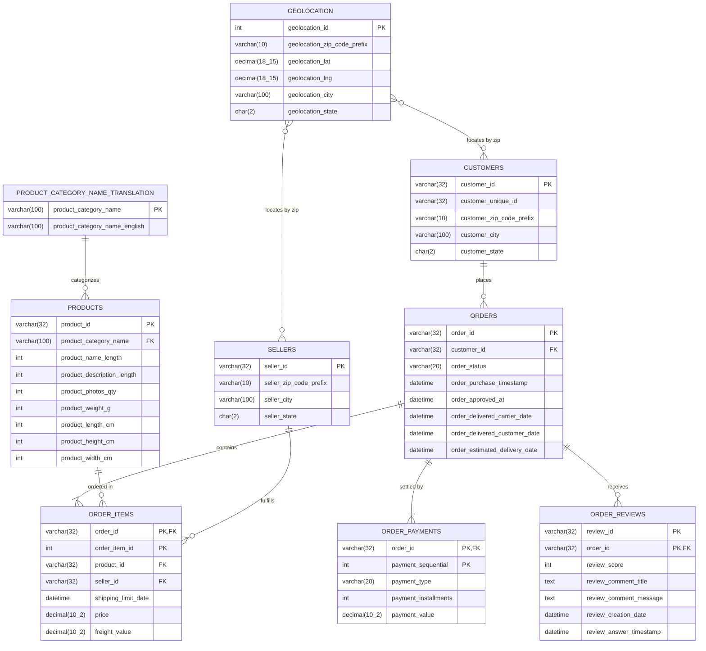

# Entity-Relationship (ER) Diagram: Brazilian E-Commerce Database

The following diagram represents the relational schema implemented in **MySQL 8.0** for the Olist E-Commerce dataset.

### Table Relationships & Cardinality
1. **`CUSTOMERS` to `ORDERS` (1 : M)**: A single customer entity can place multiple orders over time. Note that `customer_id` is unique per transaction, while `customer_unique_id` tracks repeat individuals.
2. **`ORDERS` to `ORDER_ITEMS` (1 : M)**: An individual order can contain one or multiple line items.
3. **`ORDERS` to `ORDER_PAYMENTS` (1 : M)**: An order can be split across multiple payment methods or installment vouchers.
4. **`ORDERS` to `ORDER_REVIEWS` (1 : M)**: An order may receive customer feedback surveys.
5. **`PRODUCTS` to `ORDER_ITEMS` (1 : M)**: Products can be ordered multiple times across distinct orders.
6. **`SELLERS` to `ORDER_ITEMS` (1 : M)**: Marketplace merchants can fulfill multiple ordered items.
7. **`PRODUCT_CATEGORY_NAME_TRANSLATION` to `PRODUCTS` (1 : M)**: Lookup table mapping Brazilian Portuguese categories to international English names.
8. **`GEOLOCATION` to `CUSTOMERS` / `SELLERS` (M : N via Zip Prefix)**: Multi-observation spatial coordinate mapping. A Brazilian 5-digit zip code prefix (`CEP`) encompasses multiple spatial coordinate points. Spatial analyses derive centroid coordinates via `AVG(geolocation_lat), AVG(geolocation_lng)` to calculate buyer-merchant freight distances.
